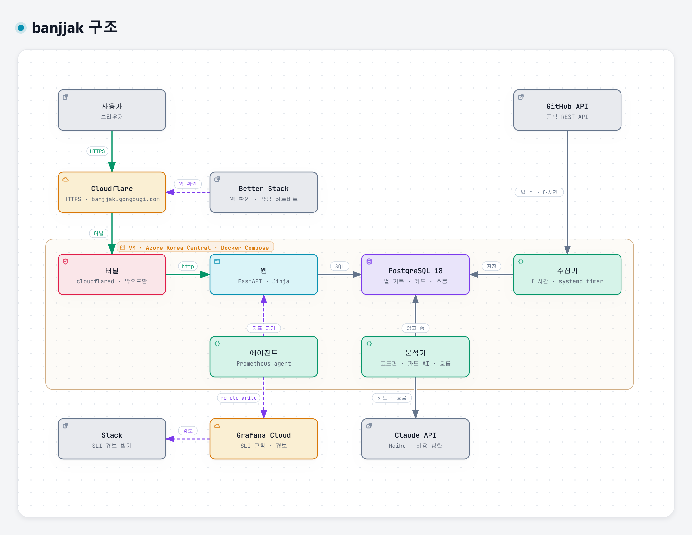
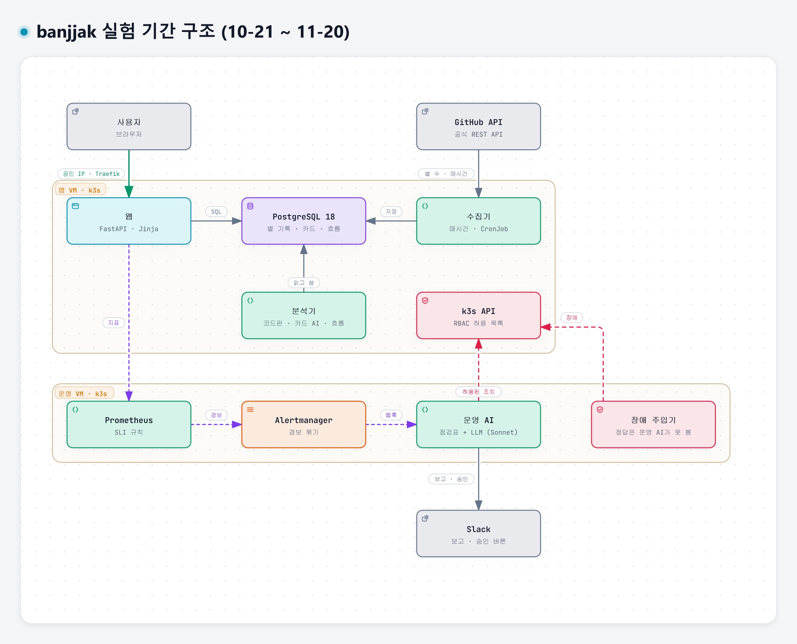

# banjjak (반짝)

[](https://github.com/gongbugi/banjjak/actions/workflows/ci.yml)

**지금 뜨는 GitHub 레포를 AI가 쉽고 빠르게 정리하고, AI가 함께 운영하는 서비스.** → https://banjjak.gongbugi.com

GitHub Trending은 "왜 뜨는지", "나한테 필요한지"를 알려 주지 않는다. banjjak은 매시간 별 증가로 순위를 직접 매기고, 레포마다 무엇을 하는지 한 장으로 정리하고, 비슷한 레포가 함께 뜨는 흐름을 묶어 보여 준다.

## 무엇을 하나

| | |
|---|---|
| **순위** | 매시간 GitHub 공식 API로 별 수를 모아 하루 실제 증가로 순위를 낸다. 탭 두 개: 30일 안에 생긴 레포 · 전체 레포 |
| **카드** | README를 읽고 무엇을 하는지 · 분야 · 쓰는 법을 한 장으로. 코드판 카드를 AI(Claude Haiku)가 다듬는다 |
| **지금 뜨는 흐름** | 순위의 한 줄 설명을 AI가 읽어, 비슷한 레포가 여럿 함께 뜨는 흐름을 0 ~ 5개로 묶는다. 흐름을 누르면 그 레포만 남는다 |
| **운영 AI** | 경보가 울리면 점검표와 LLM(Claude Sonnet)이 원인을 진단하고, 위험 등급에 따라 알리기만 하거나 조치했다. 보고와 승인 버튼은 Slack으로. 한 달 실험(아래) 동안 돌았다 |
| **장애 주입기** | 무작위로 서비스를 망가뜨리고 정답을 운영 AI가 못 보는 곳에 남겼다. 그 정답으로 운영 AI를 채점했다 |

## AI 출력은 코드가 검증한다

LLM이 쓴 글은 그대로 화면에 나가지 않는다.

- 요약의 근거 문장은 README 원문과 대조한다. 원문에 없는 문장을 인용하면 카드는 코드판으로 돌아간다
- 분야 태그는 정해진 목록에서만, 쓰는 법은 README 코드 블록을 글자 그대로
- 흐름의 소속은 보낸 번호에서만 고르고, 소속 레포마다 핵심 말이 그 레포 설명에 있어야 한다. 개수 · 순위 같은 숫자는 화면에서 코드가 센다
- 링크 · HTML · 깨진 글자는 막는다. 어떤 실패든 화면은 AI 없이 그대로 나온다
- 비용은 장부로 센다. 하루 · 전체 상한을 넘으면 호출하지 않는다

## 운영 AI는 권한으로 막는다 (한 달 실험)

| 등급 | 하는 일 | 예 |
|---|---|---|
| T1 | 보고 뒤 5분 안에 거부가 없으면 실행 | 웹 롤백 · 수집기 · 분석기 재개 |
| T2 | 사람이 승인해야 실행 | 앱 VM 재시작 |
| 조치 없음 | 보고만 하고 사람에게 | 원인을 모르는 경보 · 할 수 있는 조치가 없는 원인 |

- 운영 AI 계정은 허용 목록의 조치만 할 수 있다 (Kubernetes RBAC · 승인 정책). 코드 검사로 대신하지 않는다
- 장애 주입기와 정답 기록이 있는 곳은 운영 AI가 읽지도 못한다
- 조치 뒤에는 경보가 풀렸는지 다시 보고, 안 풀리면 사람에게 넘긴다

## 한 달 실험 (2026-10-21 ~ 11-20)

장애 주입기가 무작위로 장애를 넣고, 운영 AI가 탐지 · 진단 · 조치했다. 끝난 뒤 정답과 판단을 대조했다 ([#12 결과](https://github.com/gongbugi/banjjak/issues/12#issuecomment-7036462954), `deploy/grade.py`).

| | 결과 (장애 주입 10-24 ~ 11-20) |
|---|---|
| 주입 | 22건 |
| 탐지 | 경보가 나야 하는 17건 모두, 탐지까지 중앙값 7분. 파드 종료 5건은 k8s가 경보 전에 되살렸다 |
| 원인 판단 | 점검표 17/17 · LLM 9/9. LLM을 켠 뒤 같은 9건에서 점검표도 9/9 → LLM이 점검표보다 낫다는 근거는 없었다 |
| 조치 | 조치가 필요한 7건 중 5건을 운영 AI가 고쳤다 (T1). 나머지 2건은 사람 승인(T2)으로 올라갔고 사람이 고치지 않았다 |
| 오탐 | 1건 (주입 없이 울린 경보) |
| LLM 비용 | $0.1351 (운영 AI, 20일) |

표본이 작다 (종류당 1 ~ 6건). 맹검 틈 1건 등 한계는 #12 결과에 적었다.

## 구조

<picture>
  <source media="(prefers-color-scheme: dark)" srcset="docs/img/architecture-dark.png">
  
</picture>

<sub>그림 원본: <code>docs/img/architecture.archify.json</code> (<a href="https://github.com/tt-a1i/archify">archify</a>)</sub>

- 서버: Azure VM 1대 (Korea Central, 메모리 1GB), Docker Compose. 매시 작업은 systemd timer가 부른다 (`deploy/compose/`)
- 입구: Cloudflare Tunnel. VM이 Cloudflare로 밖으로만 연결하고, HTTPS는 Cloudflare가 맡는다. VM에는 공인 IP도 들어오는 포트도 없다
- 배포: main 푸시 → 시험 · 이미지 빌드 → GitHub에서 승인 한 번 → VM 안에서 compose로 (GitHub OIDC, 저장된 키 없음, Azure run-command). 새 웹이 준비 안 되면 앞 커밋으로 되돌린다
- 비밀값은 실행할 때 VM의 파일로만 붙인다. 이미지와 레포에는 없다 (넣을 때는 `deploy/vm_secret.py`, 역시 run-command)
- 지표 · 경보: VM의 Prometheus 에이전트가 Grafana Cloud(무료)로 보내고, SLI 경보는 Grafana가 Slack으로 보낸다. 규칙의 원본은 `deploy/ops/rules.yml` (`deploy/grafana_cloud.py`로 올린다)
- 바깥 감시: Better Stack (웹 모니터 · 작업 하트비트)

<details><summary>실험 기간 구조 (VM 2대 · k3s)</summary>

<picture>
  <source media="(prefers-color-scheme: dark)" srcset="docs/img/experiment-dark.png">
  
</picture>

앱과 운영을 나눠 운영 AI가 앱과 같이 죽지 않게 했다. 실험이 끝난 11-20에 운영 VM을 지우고, 앱 VM을 1GB · compose로 줄였다 (`deploy/compose/from-k3s.sh`).

</details>

## 목표 수준 (SLI)

| 지표 | 목표 |
|---|---|
| 가용성 | 99% |
| 응답 시간 p95 | 500ms |
| 데이터 신선도 | 2시간 |
| 분석 성공률 | 95% |

실험 동안은 운영 VM의 Prometheus로 쟀다. 지금은 Grafana Cloud가 같은 규칙으로 재고, Better Stack이 밖에서 가용성(`/healthz`) · 신선도(`/freshness`)를 따로 본다.

## 기술

| | |
|---|---|
| **앱** |      |
| **데이터** |  |
| **AI** |  |
| **배포 · 운영** |      |
| **관측 · 알림** |    |
| **실험 기간** |      |

## 디렉터리

| 경로 | 무엇 |
|---|---|
| `app/banjjak/` | 앱: 수집기 · 순위 · 분석기 · 카드 AI · 흐름 · 웹 · 운영 AI · 장애 주입기 |
| `app/tests/` | 시험 (pytest) |
| `app/migrations/` | DB 스키마 (Alembic) |
| `deploy/compose/` | 앱 VM: compose · systemd timer |
| `deploy/` | 배포(`on-vm.sh`) · 시험장 · 재생 · 채점 · 내보내기 스크립트 |
| `deploy/k8s/` | k3s 매니페스트 (실험 기간 · 로컬 k3d) |
| `deploy/ops/` · `deploy/opsai/` · `deploy/chaos/` | 운영 클러스터 (실험 기간): 지표 · 경보 · 운영 AI · 장애 주입기 |
| `infra/azure/` | VM · 권한 · 비밀값 설정 스크립트 (값은 실행할 때 입력, 레포에 없다) |

## 로컬 실행

```bash
cd app && pip install -e ".[dev]" && pytest && uvicorn banjjak.main:app --reload
```

시험은 PostgreSQL이 필요하다 (`TEST_DATABASE_URL`, 기본 `localhost:55432`).
